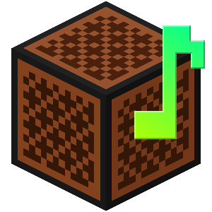
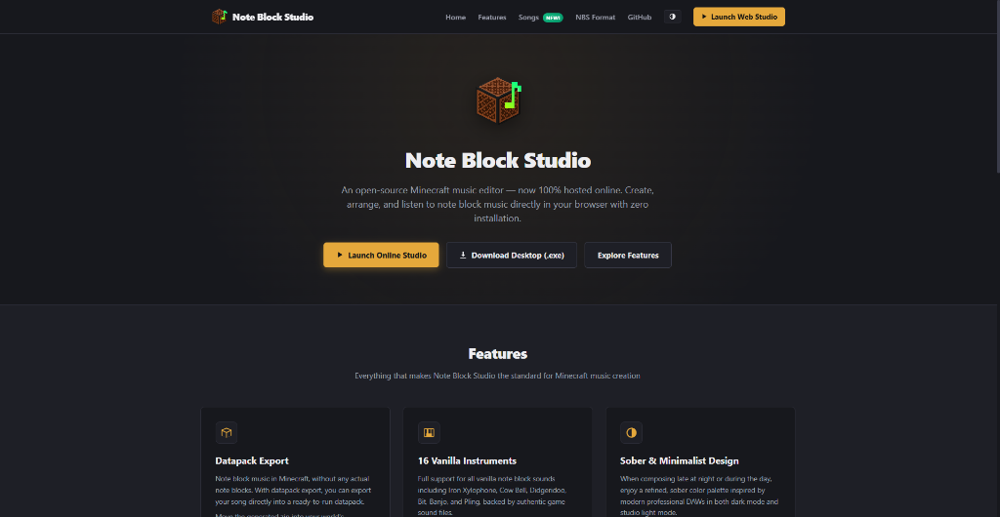

  

  # Note Block Studio Online

  **The modern, in-browser Minecraft music editor.**  
  *Create, arrange, and export note block music directly in your web browser on any device — zero installation required.*

   

  
  
  
  

   

  [**🎵 Launch Online Studio**](https://noteblock-studio.pages.dev) &nbsp;&bull;&nbsp;
  [**📖 Read Documentation**](https://noteblock-studio.pages.dev/docs.html) &nbsp;&bull;&nbsp;
  [**🐛 Report an Issue**](https://github.com/BlankDEVgit/noteblock-studio-community/issues/new/choose)

   

  

---

## 🌟 About Note Block Studio Online

**Note Block Studio Online** is a full-featured digital audio workstation (DAW) designed specifically for Minecraft music creators. It runs 100% client-side in any modern web browser — on Windows, macOS, Linux, Chromebook, iPad, and mobile devices — without downloading any executables, installers, or Java runtimes.

All audio scheduling, binary parsing, and export generation happen directly on your device using the Web Audio API and HTML5 Canvas. Your songs and files remain completely private.

---

## ✨ Features at a Glance

- **Works on Any Device**: Open the web application and start composing immediately with zero setup.
- **16 Vanilla Minecraft Instruments**: Includes Harp, Double Bass, Bass Drum, Snare, Sticks, Guitar, Flute, Bell, Chime, Xylophone, Iron Xylo, Cow Bell, Didgeridoo, Bit, Banjo, and Pling with authentic 44.1kHz game samples.
- **Multi-Track DAW Sequencer**: Unlimited track layers with Solo (`S`), Mute (`M`), Track Lock, individual Volume sliders (0–100%), and Stereo Panning (0 to 200).
- **88-Key Interactive Piano Roll**: Visualizes full acoustic range and highlights Minecraft's native 2-octave range (`F#3` to `F#5` / keys 33–57). Keys animate and illuminate in real-time during playback.
- **Minecraft Datapack Export (`.zip`)**: Export ready-to-run datapacks with 3D stereo sound coordinates and tick scheduling. Play in-game using `/function <song>:play`.
- **Redstone Repeater Schematics**: Generates `.mcfunction` builder scripts placing note blocks on exact substrate blocks (dirt, stone, gold, packed ice, etc.) with timed redstone repeaters.
- **Studio WAV Audio Export**: Renders studio-quality 44.1kHz 16-bit Stereo WAV files directly in the browser faster than real-time.
- **OpenNBS & MIDI Support**: Full binary round-trip compatibility with `.nbs` format versions (v0 classic to v5 modern) and Standard MIDI (`.mid`) files.

---

## 🐛 Community Issue Tracker & Feedback

This public repository serves as the official **community issue tracker, feature request forum, and feedback hub** for Note Block Studio Online.

If you encounter a problem or have an idea to improve the studio:

| Type | Description | Link |
| :--- | :--- | :--- |
| **Bug Report** | Found an issue, glitch, or unexpected behavior? | [Submit Bug Report](../../issues/new?template=bug_report.md) |
| **Feature Request** | Have an idea or workflow improvement? | [Submit Feature Request](../../issues/new?template=feature_request.md) |
| **Song Compatibility** | An `.nbs` or `.mid` file isn't playing or importing as expected? | [Submit Song Issue](../../issues/new?template=song_compatibility.md) |

You can also browse existing topics or search resolved issues in the **[Issues Tab](../../issues)**.

---

## 🔒 Repository Architecture & Privacy

> **Note for Developers & Users:**  
> This public repository contains the community documentation, issue templates, and project showcase. The core application engine is developed and maintained in a private repository to protect proprietary software assets.

---

## 💬 Community

- **Discord Server:** Join our community Discord to share songs, get feedback, and chat with other note block composers: [discord.gg/w35BqQp](https://discord.gg/w35BqQp)

---

## 📜 Copyright & Legal Disclaimer

- **Note Block Studio Online** is created and maintained by **Dylan**. Copyright &copy; 2026 Dylan. All rights reserved.
- *Minecraft* is a trademark of Mojang Synergies AB. Note Block Studio Online is an independent community software and is not affiliated with or endorsed by Mojang or Microsoft.
